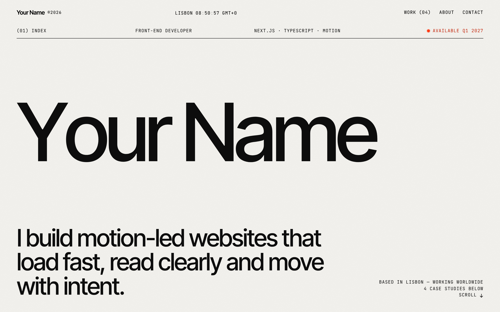
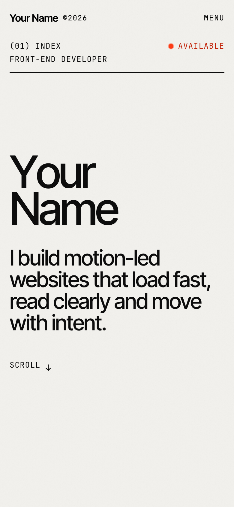
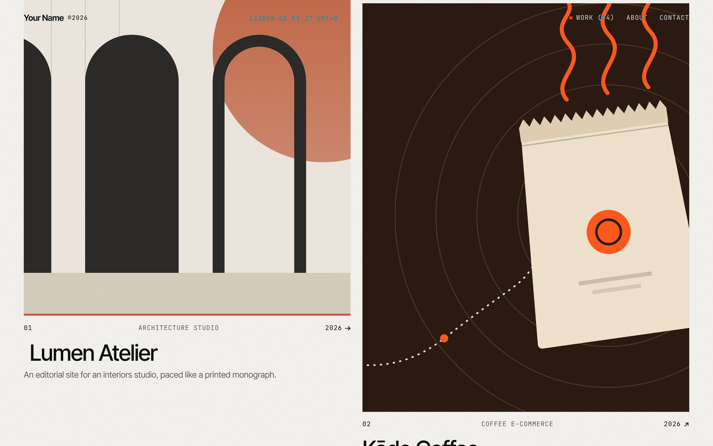
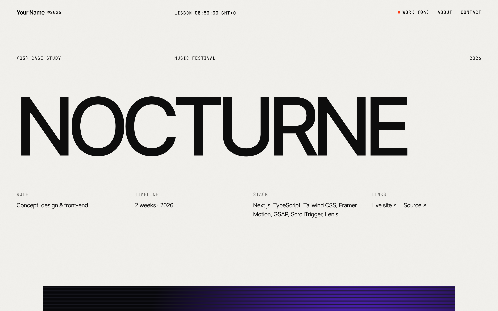

# INDEX — Front-end Developer Portfolio

**A typographic, motion-led portfolio hub: one giant name, a hover-preview work index, curtain page transitions and four in-depth case studies, all driven by a single content file.**

INDEX is the home for four concept sites (Lumen Atelier, Kōdo Coffee, NOCTURNE and VANTA). It reads like a well-set catalogue: warm paper, near-black ink, one signal-red accent, hairline rules and a strict 12-column grid. The motion is precise and expo-eased. Headlines rise from masks, rules draw in, and every page change runs through a curtain that carries the destination's name.



<p align="center">
  
</p>

| `/work` (card hovered) | Case study hero |
|---|---|
|  |  |

---

## Motion highlights

- **Preloader (first visit only).** A mono counter runs 00 → 100 and holds at 90 until the web fonts are ready. It plays only when the session starts on `/`, then hands straight over to the hero intro.
- **Hero intro.** "Your Name" rises character by character from a mask (GSAP SplitText). The meta row, the hairline rule, the statement lines and the mono stack follow in sequence. The availability dot pulses and the scroll cue bobs.
- **Work index with hover preview.** On desktop, a floating cover follows the pointer on springs (Framer Motion). It tilts with pointer velocity, wipes between projects with a clip-path, and its label lags slightly behind. The other rows dim, an ink band wipes up behind the active row, and the title slides. When you tab to a row, the preview anchors to it. On touch screens, each row shows its cover inline instead.
- **Curtain page transitions.** Every internal link runs an ink curtain (or the project's own colour on case links) that shows the destination's index and name. The curtain locks scroll, swaps the route, lands the page at the top and moves focus to the new `<h1>`. Back/forward uses a quick crossfade instead.
- **Sticky scrub statement.** The about statement is pinned while each word brightens as you scroll, and a live counter (`03 — 42%`) tracks your progress. Highlight words turn signal red.
- **Case studies.** The cover frame opens with a clip-path and its SVG layers drift at three parallax depths. VANTA gets a light sweep and NOCTURNE's bars grow in a seeded order. Highlight rows draw their rules, palette swatches rise, stack pills stagger in and target stats count up. The "Next case" title slides on hover.
- **Footer.** It reveals from under the page. "Let's talk" rises by character and the magnetic "Start a project" button pops in. On a fine pointer, the button pulls toward the cursor and an ink disc fills it from the entry point.
- **Page chrome.** Lenis smooth scroll runs on the GSAP ticker. The header hides on scroll down and returns on scroll up (it stays visible while focused or while the menu is open). There is also a live local-time clock with a blinking colon, and a full-screen mobile menu with a clip-wipe and staggered link rise.

Animations only use `transform`, `opacity` and `clip-path`. Every cover is generated inline SVG, so the site loads no remote images.

## Tech stack

| | |
|---|---|
| Framework | [Next.js 16](https://nextjs.org) (App Router, Turbopack, fully static: `generateStaticParams`) |
| Language | TypeScript (strict) |
| Styling | Tailwind CSS v4 (design tokens in `@theme`, `src/app/globals.css`) |
| Scroll motion | [GSAP 3](https://gsap.com) with ScrollTrigger, SplitText and `@gsap/react` |
| UI motion | [Motion](https://motion.dev) (Framer Motion): curtain, hover preview, mobile menu |
| Smooth scroll | [Lenis](https://lenis.darkroom.engineering) |
| Fonts | Inter Tight + JetBrains Mono via `next/font/google` |

## Routes

| Route | What it is |
|---|---|
| `/` | Hero, selected work index, about statement, capabilities, contact |
| `/work` | Two-column grid of all projects with parallax cards |
| `/work/[slug]` | Case study for `lumen-atelier`, `kodo-coffee`, `nocturne` and `vanta` |
| `/about` | Bio, portrait, principles, experience and toolbox |
| any other path | 404 ("This entry is not in the index.") |

## Project structure

```
src/
  app/              layout (fonts, boot script, providers), template.tsx (page wrapper),
                    routes, globals.css (tokens + component styles), icon, OG image
  animations/       usePageMotion (one GSAP context per page), split / scroll reveals,
                    parallax, scrub words, count-up, magnetic, header hide, easings
  components/
    home/           Hero, WorkIndex, HoverPreview, AboutStatement, Capabilities
    work/           WorkGrid, WorkCard
    case/           CaseHero, CaseCover, CaseSection, MotionHighlights, PaletteStrip,
                    StackList, TargetStats, NextProject
    about/          AboutHero, PortraitTilt, Bio, Principles, Experience, StackGrid
    layout/         Header, MobileMenu, Footer, Clock, SkipLink, Grain, BackToTop…
    transition/     TransitionProvider, Curtain, Preloader, TransitionLink
    media/          Media (swappable slot: svg | image | video), Portrait, covers/
    providers/      SmoothScroll (Lenis)
    ui/             MagneticButton, SplitHeading, SectionLabel, Rule, Tag, ArrowIcon
  content/          site.ts (all copy, links and projects), types.ts, helpers.ts
  lib/              gsap.ts (plugin registration), hooks and utils
```

## Getting started

Requires Node 22 and npm.

```bash
npm install
npm run dev        # http://localhost:3000
npm run build      # production build (every route is prerendered)
npm run start      # serve the production build
npm run lint       # ESLint
npx tsc --noEmit   # type-check
```

Deploy to Vercel (or any Node host) with no extra configuration.

## Make it yours

Everything you need to change is in **`src/content/site.ts`**. Look for the `// PLACEHOLDER` comments:

1. **Identity.** At the top of the file, set `NAME`, `INITIALS`, `EMAIL` and `SITE_URL`. The name flows into the hero, header, footer, bio and SEO metadata.
2. **Location & availability.** Set `location` (city, country and an IANA `timeZone` for the live clock), `availability` and the hero `meta`.
3. **Socials.** Replace the `socials` links, or remove the ones you don't use.
4. **Project links.** Each project has a **`liveUrl`** (defaults to `"#"`). Paste each site's URL here once it is deployed. `sourceUrl` is optional, and removing it hides the "Source" link.
5. **Copy.** Edit the about statement (wrap words in `*asterisks*` to italicise them), bio, experience, principles, toolbox and capabilities.
6. **Covers and portrait.** Covers are generated SVG art. To use a real screenshot instead, put the file in `public/` and change a project's `cover` to:
   ```ts
   cover: { kind: "image", src: "/covers/lumen.jpg", alt: "…", width: 1600, height: 1000 }
   ```
   (`kind: "video"` with `src` and `poster` also works). Swap `about.portrait` the same way to use a photo.
7. **Colours and type.** The tokens (paper, ink, signal) live in the `@theme` block of `src/app/globals.css`. Each project's palette drives its curtain colour and its case-study swatches.

## Accessibility & reduced motion

- Semantic landmarks, a skip link and one `<h1>` per page. After every page transition, focus moves to the new heading.
- A visible 2px focus ring on every interactive element and a logical tab order. The mobile menu is a modal dialog: it traps focus, closes on Esc, returns focus to the toggle, and makes the page behind it inert. Keyboard focus on a work row anchors the hover preview to it.
- Split text stays in the accessibility tree: headings keep an `aria-label`, and scroll-revealed text is hidden with opacity only.
- **`prefers-reduced-motion: reduce`** gives you a fully static, fully readable site. There is no Lenis, preloader, curtain, split, parallax, magnetism, tilt or header hide. Pages simply crossfade over 0.2s.
- **No JavaScript?** Every page renders its full content. Only `[data-intro]` elements are hidden before the intro, and only when an inline boot script has confirmed that JS is running. Failsafes reveal everything if an animation never starts.
- Covers sit in aspect-ratio boxes and fonts use `next/font`, so layout shift stays at zero.

## Credits

- Design, code and motion: Your Name. Built as a concept portfolio, and every brand, project and line of copy here is fictional.
- Typefaces: [Inter Tight](https://fonts.google.com/specimen/Inter+Tight) and [JetBrains Mono](https://fonts.google.com/specimen/JetBrains+Mono) (SIL Open Font License).
- Libraries: [Next.js](https://nextjs.org), [GSAP](https://gsap.com), [Motion](https://motion.dev), [Lenis](https://lenis.darkroom.engineering) and [Tailwind CSS](https://tailwindcss.com).
